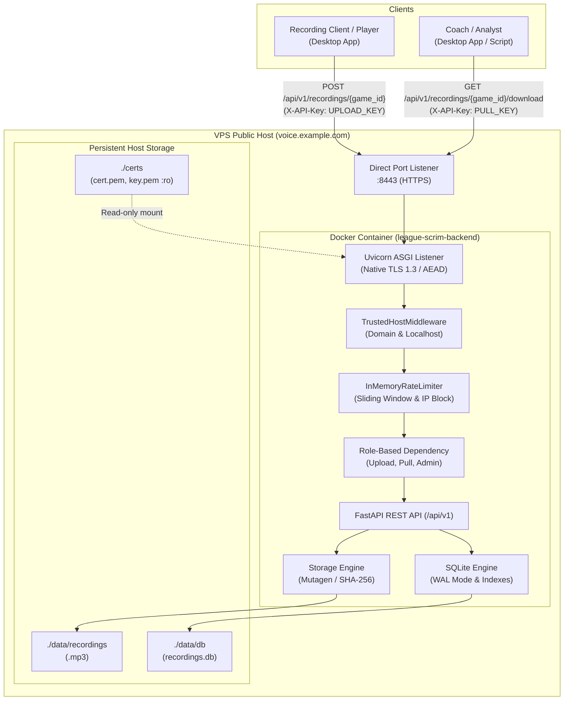

# 🐳 League Voice Recorder Backend
### Centralized Direct-Port Scrim Audio Backend
**Production-Ready | Docker | Alpine Linux | FastAPI | TLS 1.3 | SQLite WAL**

---

## 1. 🎯 Project Overview

`league-voice-recorder-backend` is a high-performance, headless remote audio storage service designed specifically for the [League Voice Recorder](https://github.com/betterix/league-voice-recorder) desktop application. 

It provides esports organizations, competitive teams, players, coaches, and analysts with a centralized, secure repository for storing, organizing, querying, and downloading League of Legends scrimmage voice recordings directly keyed by Riot Game ID (e.g. `8018190134.mp3`).

### Key Capabilities
- **Pure Headless REST API**: Zero frontend overhead, no static assets, no administrative browser panels.
- **Direct-Port Network Architecture**: Exposes direct HTTPS on port `8443` without mandatory reverse proxies (Nginx/Traefik) or CDN buffering.
- **Native TLS 1.3 Termination**: Uvicorn-managed native SSL using OpenSSL AEAD cipher suites, supporting production Let's Encrypt certificates and development self-signed fallback.
- **Three-Tier Role-Based Security**: Cryptographically isolated `UPLOAD_KEY`, `PULL_KEY`, and optional `ADMIN_KEY` validated with constant-time comparisons (`secrets.compare_digest`).
- **High-Performance Audio Pipeline**: Streaming chunked uploads, bounded memory usage, Mutagen-based MPEG validation, SHA-256 integrity verification, and atomic disk commits.
- **Resumable Audio Transfers**: Full HTTP Range header support (`206 Partial Content`, `416 Range Not Satisfiable`) for chunked, interrupted, or resumable MP3 downloads.
- **Hardened SQLite Engine**: Configured with Write-Ahead Logging (`WAL`), `synchronous=NORMAL`, 30-second busy timeouts, and indexed queries.
- **Production Alpine Container**: Multi-stage Docker build producing a ~140 MB image running as an unprivileged non-root user (`appuser:appuser`, UID `10001`).

---

## 2. 🧭 Core Architecture & Design Philosophy



---

## 3. 📁 Repository Structure

```text
league-voice-recorder-backend/
├── app/
│   ├── __init__.py           # Package version (1.0.0)
│   ├── config.py             # Pydantic Settings & environment validation
│   ├── security.py           # Authentication, role enforcement, rate limiting, TLS utils
│   ├── database.py           # SQLite engine, WAL pragma, session management
│   ├── models.py             # SQLAlchemy models & database schema
│   ├── schemas.py            # Pydantic request/response schemas
│   ├── storage.py            # MP3 validation, streaming, range requests, path sanitization
│   ├── main.py               # FastAPI app, middleware, lifespan, TLS 1.3 listener
│   └── api/
│       ├── __init__.py       # Router definitions
│       ├── health.py         # Health diagnostics & storage telemetry
│       └── recordings.py     # Recording upload, list, download, metadata, deletion
├── certs/
│   └── .gitkeep              # Mounted directory for TLS certificates
├── tests/
│   ├── __init__.py           # Test suite package
│   ├── conftest.py           # Fixtures, test database, and synthetic MP3 generator
│   ├── test_security.py      # Auth, brute-force IP blocking, rate limits, TLS tests
│   ├── test_upload.py        # Upload validation, checksums, duplicate and path traversal tests
│   ├── test_download.py      # Range requests, partial content, download security tests
│   └── test_api.py           # Health checks, listing, pagination, search, delete tests
├── .dockerignore             # Docker build context exclusions
├── .env.example              # Sample environment configuration template
├── .gitignore                # Source control exclusions
├── Dockerfile                # Multi-stage hardened Alpine container definition
├── docker-compose.yml        # Production deployment compose file
├── pyproject.toml            # Project dependencies and tool configurations
├── requirements.txt          # Production package pins
└── README.md                 # Complete operational documentation
```

---

## 4. ⚙️ System Requirements

### Production Server
- **Operating System**: Linux (Ubuntu 22.04 / 24.04 LTS, Debian 12, or Alpine Linux recommended)
- **CPU**: 1 vCPU minimum (2+ vCPU recommended for concurrent scrim uploads)
- **RAM**: 512 MB minimum (1 GB recommended)
- **Disk Space**: Sized according to team scrim audio retention (~60–100 MB per hour of 128kbps stereo recording)
- **Runtime**: Docker Engine 24.0+ and Docker Compose v2.20+
- **Network**: Direct public IPv4 address with direct inbound access to port `8443` (TCP) and port `80` (TCP, for ACME challenge during certificate renewal)

### Local Development
- Python 3.14+
- `uv` package manager (or pip)

---

## 5. 🔐 Authentication & Permission Architecture

All private endpoints require the `X-API-Key` HTTP header:

```http
X-API-Key: <SECRET_KEY>
```

### 5.1 Three-Key Permission Matrix

| Operation | Endpoint | `PULL_KEY` | `UPLOAD_KEY` | `ADMIN_KEY` |
|---|---|:---:|:---:|:---:|
| **Health Check & Diagnostics** | `GET /api/v1/health` | ✅ | ✅ | ✅ |
| **List Recordings** | `GET /api/v1/recordings` | ✅ | ✅ | ✅ |
| **Get Recording Metadata** | `GET /api/v1/recordings/{game_id}` | ✅ | ✅ | ✅ |
| **Download Recording** | `GET /api/v1/recordings/{game_id}/download` | ✅ | ✅ | ✅ |
| **Upload Recording** | `POST /api/v1/recordings/{game_id}` | ❌ *(403)* | ✅ | ✅ |
| **Delete Recording** | `DELETE /api/v1/recordings/{game_id}` | ❌ *(403)* | ❌ *(403)* | ✅ |

### 5.2 Security Implementation
- **Constant-Time Comparison**: Key comparisons execute via `secrets.compare_digest()` to eliminate timing attack vectors.
- **Zero API Key Leakage**: API keys are excluded from application logs, error traces, and health telemetry.
- **Production Validation**: At startup, production settings mandate distinct secrets, disallow default template values, require keys with a minimum length of 32 characters, and enforce character diversity/entropy checks.
- **Persistent Tokens**: Tokens are defined in `.env` and remain persistent across container restarts and host reboots. They never rotate automatically.

### 5.3 Cryptographic Key Generation CLI
To generate fresh, cryptographically secure 256-bit CSPRNG API keys at any time, run:

```bash
uv run python -m app.security
```

**Example Output:**
```text
=== League Voice Recorder Cryptographically Secure Keys ===
UPLOAD_KEY=lvr_upload_<32_random_urlsafe_bytes>
PULL_KEY=lvr_pull_<32_random_urlsafe_bytes>
ADMIN_KEY=lvr_admin_<32_random_urlsafe_bytes>
```

Each generated token includes:
- **Role Identifier Prefix**: `lvr_upload_`, `lvr_pull_`, or `lvr_admin_` for immediate secret identification.
- **256-Bit Entropy**: 32 CSPRNG bytes from `/dev/urandom` encoded in URL-safe base64.

---

## 6. 🌐 REST API Specification

Base prefix: `/api/v1`

### 6.1 Health & Diagnostics

#### `GET /api/v1/health`
Confirms service status and reports real-time storage metrics and role identification. Strictly requires a valid API key.

- **Permissions**: `PULL_KEY`, `UPLOAD_KEY`, or `ADMIN_KEY`
- **Headers**: `X-API-Key: <SECRET_KEY>` *(Required)*
- **Responses**:
  - `200 OK`:
    ```json
    {
      "status": "ok",
      "version": "1.0.0",
      "authenticated_role": "pull",
      "storage_total_bytes": 107374182400,
      "storage_used_bytes": 15728640000,
      "storage_free_bytes": 91645542400,
      "recording_count": 142
    }
    ```
  - `401 Unauthorized`: Missing or invalid API key.

---

### 6.2 Scrim Audio Management

#### `POST /api/v1/recordings/{game_id}`
Upload and validate a scrimmage recording MP3 file.

- **Permissions**: `UPLOAD_KEY` or `ADMIN_KEY`
- **Headers**:
  - `X-API-Key`: `UPLOAD_KEY` *(Required)*
  - `X-Checksum-SHA256`: `<64-char-hex>` *(Optional, validated if provided)*
- **Path Parameters**:
  - `game_id`: Riot Game ID (alphanumeric, underscore, hyphen, 1–64 characters)
- **Form Data** (`multipart/form-data`):
  - `file`: MP3 audio file *(Required)*
  - `team_tag`: Team identifier string, e.g. `T1` *(Optional)*
  - `notes`: Custom scrim context notes *(Optional)*
  - `match_date`: Match date string, e.g. `2026-11-10` *(Optional)*
- **Responses**:
  - `201 Created`:
    ```json
    {
      "game_id": "8018190134",
      "filename": "8018190134.mp3",
      "file_size": 25165824,
      "duration": 1845.2,
      "bitrate": 128000,
      "sample_rate": 44100,
      "upload_timestamp": "2026-11-10T12:00:00Z",
      "team_tag": "T1",
      "notes": "Game 1 vs Gen.G LCK Finals",
      "match_date": "2026-11-10",
      "sha256": "e3b0c44298fc1c149afbf4c8996fb92427ae41e4649b934ca495991b7852b855"
    }
    ```
  - `400 Bad Request`: Invalid Game ID format, corrupted MP3, or SHA-256 checksum mismatch.
  - `401 Unauthorized`: Missing or invalid API key.
  - `403 Forbidden`: Attempted upload using a read-only `PULL_KEY`.
  - `409 Conflict`: Recording for this Game ID already exists.
  - `413 Payload Too Large`: Upload exceeds configured `MAX_UPLOAD_MB`.
  - `429 Too Many Requests`: Upload rate limit exceeded.

---

#### `GET /api/v1/recordings`
Query and list stored recording metadata with pagination and search.

- **Permissions**: `PULL_KEY`, `UPLOAD_KEY`, or `ADMIN_KEY`
- **Query Parameters**:
  - `skip`: Integer offset (default: `0`)
  - `limit`: Integer records per page (default: `50`, max: `100`)
  - `search`: Filter string matching Game ID or Team Tag (case-insensitive)
- **Responses**:
  - `200 OK`:
    ```json
    {
      "items": [
        {
          "game_id": "8018190134",
          "filename": "8018190134.mp3",
          "file_size": 25165824,
          "duration": 1845.2,
          "bitrate": 128000,
          "sample_rate": 44100,
          "upload_timestamp": "2026-11-10T12:00:00Z",
          "team_tag": "T1",
          "notes": "Game 1 vs Gen.G LCK Finals",
          "match_date": "2026-11-10",
          "sha256": "e3b0c44298fc1c149afbf4c8996fb92427ae41e4649b934ca495991b7852b855"
        }
      ],
      "total": 1,
      "skip": 0,
      "limit": 50
    }
    ```

---

#### `GET /api/v1/recordings/{game_id}`
Retrieve metadata for a specific scrimmage recording.

- **Permissions**: `PULL_KEY`, `UPLOAD_KEY`, or `ADMIN_KEY`
- **Responses**:
  - `200 OK`: Metadata object.
  - `404 Not Found`: Recording does not exist.

---

#### `GET /api/v1/recordings/{game_id}/download`
Stream the MP3 audio file directly to the client with full HTTP Range support.

- **Permissions**: `PULL_KEY`, `UPLOAD_KEY`, or `ADMIN_KEY`
- **Headers (Optional)**:
  - `Range`: `bytes=0-1048575` *(Byte range specification)*
- **Responses**:
  - `200 OK`: Full file stream.
    - `Content-Type`: `audio/mpeg`
    - `Content-Disposition`: `attachment; filename="8018190134.mp3"`
    - `Accept-Ranges`: `bytes`
    - `Content-Length`: `<total_bytes>`
  - `206 Partial Content`: Successful range slice transfer.
    - `Content-Range`: `bytes 0-1048575/25165824`
    - `Content-Length`: `1048576`
  - `416 Range Not Satisfiable`: Requested byte range exceeds file boundaries.
  - `404 Not Found`: Recording file not found.

---

#### `DELETE /api/v1/recordings/{game_id}`
Remove a recording file from disk and purge its metadata from the database. Strictly restricted to administrative access.

- **Permissions**: `ADMIN_KEY` only
- **Responses**:
  - `200 OK`:
    ```json
    {
      "message": "Recording '8018190134' successfully deleted",
      "game_id": "8018190134"
    }
    ```
  - `403 Forbidden`: Attempted deletion using a non-admin key (`UPLOAD_KEY` or `PULL_KEY`).
  - `404 Not Found`: Recording does not exist.

---

## 7. 🛡️ Security, Rate Limiting & Host Protection

### 7.1 In-Memory Rate Limiting Scope
The backend incorporates a thread-safe sliding-window rate limiter tailored for direct-port single-process Uvicorn deployment:

| Category | Default Limit | Action on Exceeding |
|---|---|---|
| **General API Requests** | 120 / minute / IP | Returns `429 Too Many Requests` with `Retry-After` header |
| **Upload Requests** | 10 / minute / IP | Returns `429 Too Many Requests` with `Retry-After` header |
| **Failed Authentication** | 5 / minute / IP | **Temporary IP block for 10 minutes** across all endpoints |

> [!NOTE]
> The rate limiter operates purely in memory within the container process, eliminating external Redis dependencies. In direct-port architecture, client IPs are obtained directly from the TCP socket connection (`request.client.host`). Spoofed `X-Forwarded-For` headers are strictly ignored.

### 7.2 HTTP Host Protection
FastAPI `TrustedHostMiddleware` is configured to only allow requests matching:
- The configured `DOMAIN_NAME` (e.g. `voice.example.com`)
- Subdomains (`*.example.com`)
- `localhost` and `127.0.0.1`

Any HTTP request with an unauthorized `Host` header is immediately rejected with HTTP `400 Bad Request`.

---

## 8. 🌐 DNS & Direct-Port Network Architecture

The service exposes its HTTPS listener directly over port `8443` without intermediate proxies or CDN buffering to prevent upload truncation and latency on large audio files.

### 8.1 DNS Record Setup
In your DNS provider, configure a direct A-record pointing to your VPS public IPv4 address:

| Type | Name | Content / Target | Proxy Status | TTL |
|---|---|---|---|---|
| **A** | `voice` *(or `@`)* | `<YOUR_VPS_PUBLIC_IPV4>` | **DNS Only (No proxy / No CDN)** | Auto / 300s |

> [!IMPORTANT]
> If your DNS provider offers proxying or CDN features, ensure they are **disabled (DNS-only)**. Proxies buffer streaming multipart uploads and enforce upload size caps that break large scrimmage recordings. Direct A-record routing directly to your VPS IP is required.

---

## 9. 🔒 TLS 1.3 Certificate Setup & Management

The backend enforces native TLS 1.3 encryption directly in the Uvicorn listener. You can use either **Self-Signed Certificates** (for development / private scrim servers) or **Let's Encrypt** (for publicly trusted production deployments).

### Option A: Automatic Self-Signed Certificates (Fastest)

If you don't want to configure ACME/Let's Encrypt right away, set:
```env
ENVIRONMENT=development
DEV_SELF_SIGNED_CERT=true
```
The backend will automatically generate an ECDSA P-256 certificate with Subject Alternative Names for your domain and start serving HTTPS immediately.

### Option B: Trusted Let's Encrypt Certificates (Production)

To obtain publicly trusted certificates with zero browser or client warnings, use Certbot with Let's Encrypt. 

Depending on your DNS provider and server setup, choose the method that fits your environment:

#### Method 1: Automated Cloudflare DNS-01 (Recommended for Cloudflare Users)

If your DNS is managed through Cloudflare, the DNS-01 challenge is the most robust setup:
- **Zero open ports required**: Does not bind or require port 80 or 443, eliminating conflicts with any existing web servers, reverse proxies, or Kubernetes ingresses on the host.
- **Fully automated renewal**: Renews automatically via systemd timer (`certbot.timer`) every 60 days without manual interaction.

1. **Install Certbot & Cloudflare DNS Plugin**:
   ```bash
   sudo apt-get update
   sudo apt-get install -y certbot python3-certbot-dns-cloudflare
   ```

2. **Create Cloudflare API Token**:
   - In Cloudflare Dashboard, navigate to **My Profile > API Tokens > Create Token**.
   - Use the **Edit zone DNS** template.
   - Set **Permissions**: `Zone - DNS - Edit`.
   - Set **Zone Resources**: `Include - Specific zone - yourdomain.com`.

3. **Save Credentials File**:
   ```bash
   sudo mkdir -p /etc/letsencrypt
   sudo nano /etc/letsencrypt/cloudflare.ini
   ```
   Add the following line:
   ```ini
   dns_cloudflare_api_token = <YOUR_CLOUDFLARE_API_TOKEN>
   ```
   Secure the file permissions:
   ```bash
   sudo chmod 600 /etc/letsencrypt/cloudflare.ini
   ```

4. **Issue the Certificate**:
   ```bash
   sudo certbot certonly \
       --dns-cloudflare \
       --dns-cloudflare-credentials /etc/letsencrypt/cloudflare.ini \
       --dns-cloudflare-propagation-seconds 60 \
       -d voice.example.com \
       --agree-tos \
       --email admin@example.com \
       --non-interactive
   ```

> [!TIP]
> Setting `--dns-cloudflare-propagation-seconds 60` ensures that Cloudflare's TXT record propagates globally across all authoritative nameservers before Let's Encrypt queries it, guaranteeing reliable issuance and renewal.

---

#### Method 2: Manual DNS TXT Challenge (Any DNS Provider)

If you don't want to create an API token or use another DNS provider:

```bash
sudo certbot certonly --manual --preferred-challenges dns \
    -d voice.example.com \
    --agree-tos \
    --email admin@example.com
```

Certbot will output a TXT record prompt:
- **Type**: `TXT`
- **Name**: `_acme-challenge.voice`
- **Value**: `<RANDOM_CHALLENGE_STRING>`

Add this TXT record in your DNS provider, wait ~30 seconds for DNS propagation, and press **Enter** to issue your certificate. *(Note: Manual certificates require repeating this command before the 90-day expiry).*

---

#### Method 3: Standalone HTTP-01 Challenge (Dedicated Clean VPS)

For a fresh VPS where port 80 is completely free:

```bash
sudo certbot certonly --standalone \
    -d voice.example.com \
    --agree-tos \
    --email admin@example.com \
    --non-interactive
```

---

### Installing Certificates into the Backend

Mount the issued certificates into `./certs`:

```bash
cd /home/ubuntu/dev/league-voice-recorder-backend
mkdir -p certs

sudo cp /etc/letsencrypt/live/voice.example.com/fullchain.pem ./certs/cert.pem
sudo cp /etc/letsencrypt/live/voice.example.com/privkey.pem ./certs/key.pem
sudo chmod 644 ./certs/cert.pem ./certs/key.pem
```

#### Automated Renewal & Hot-Reload Script
Configure Certbot's post-renewal deploy hook to automatically copy new certificates and restart the container when Let's Encrypt renews:

Create `/etc/letsencrypt/renewal-hooks/deploy/league-backend.sh`:

```bash
#!/bin/bash
set -e

PROJECT_DIR="/home/ubuntu/dev/league-voice-recorder-backend"

cp /etc/letsencrypt/live/voice.example.com/fullchain.pem "${PROJECT_DIR}/certs/cert.pem"
cp /etc/letsencrypt/live/voice.example.com/privkey.pem "${PROJECT_DIR}/certs/key.pem"
chmod 644 "${PROJECT_DIR}/certs/cert.pem"
chmod 644 "${PROJECT_DIR}/certs/key.pem"

# Gracefully restart the backend container to reload certificates
cd "${PROJECT_DIR}" && docker compose restart league-scrim-backend
```

Make the script executable:

```bash
sudo chmod +x /etc/letsencrypt/renewal-hooks/deploy/league-backend.sh
```

#### Verify Automated Renewal
Test that background auto-renewal and the deployment hook work seamlessly:

```bash
sudo certbot renew --dry-run
```

---

## 10. 🛡️ Host Firewall Configuration (UFW)

Secure your VPS using `ufw`:

```bash
# Allow SSH
sudo ufw allow 22/tcp

# Allow direct HTTPS scrimmage recording listener
sudo ufw allow 8443/tcp comment "League Voice Recorder HTTPS"

# Allow HTTP for Certbot ACME renewal challenges
sudo ufw allow 80/tcp comment "Certbot ACME challenge"

# Enable firewall
sudo ufw enable
sudo ufw status verbose
```

---

## 11. 🚀 Production Deployment Guide

### Step 1: Clone Repository & Create Data Directories

```bash
cd /home/ubuntu/dev/league-voice-recorder-backend

# Create host persistent storage directories
mkdir -p data/recordings data/db certs

# Assign directory ownership to container appuser (UID 10001)
sudo chown -R 10001:10001 data certs
```

### Step 2: Configure Environment Variables

```bash
cp .env.example .env
nano .env
```

Generate cryptographically secure 256-bit API keys using the built-in generator:

```bash
uv run python -m app.security
```

Copy the generated keys into `.env`:

```env
# Server Configuration
DOMAIN_NAME=voice.example.com
PORT=8443
ENVIRONMENT=production

# Storage
STORAGE_DIR=/app/data/recordings
DB_DIR=/app/data/db

# Authentication (Paste your generated 256-bit tokens here)
UPLOAD_KEY=lvr_upload_<GENERATED_RANDOM_SECRET>
PULL_KEY=lvr_pull_<GENERATED_RANDOM_SECRET>
ADMIN_KEY=lvr_admin_<GENERATED_RANDOM_SECRET>

# TLS Certificates
SSL_CERT=/app/certs/cert.pem
SSL_KEY=/app/certs/key.pem

# Upload Limits
MAX_UPLOAD_MB=250

# Rate Limiting
RATE_LIMIT_PER_MINUTE=120
UPLOAD_RATE_LIMIT_PER_MINUTE=10
AUTH_FAILURE_LIMIT_PER_MINUTE=5
```

### Step 3: Build & Launch with Docker Compose

```bash
docker compose up -d --build
```

### Step 4: Verify Deployment & TLS 1.3 Handshake

Check container status and logs:

```bash
docker compose ps
docker compose logs -f league-scrim-backend
```

Verify TLS 1.3 negotiation using `curl`:

```bash
curl -v --tlsv1.3 --tls-max 1.3 \
    -H "X-API-Key: lvr_pull_<GENERATED_RANDOM_SECRET>" \
    https://voice.example.com:8443/api/v1/health
```

Expected output confirms:
- Negotiated protocol: `TLSv1.3`
- Cipher: `TLS_AES_256_GCM_SHA384`
- Response status: `HTTP/1.1 200 OK`

---

## 12. 🔄 Maintenance & Updates

### Updating Application Code

```bash
cd /home/ubuntu/dev/league-voice-recorder-backend
git pull origin main
docker compose up -d --build
```

### Rotating API Keys

To rotate keys without downtime:

1. Generate new 256-bit keys:
   ```bash
   uv run python -m app.security
   ```
2. Update the `UPLOAD_KEY`, `PULL_KEY`, or `ADMIN_KEY` values in `.env`.
3. Apply the changes immediately to the running container:
   ```bash
   docker compose up -d
   ```
4. Distribute the updated keys to players and analysts for their desktop apps.

### Persistent Data Backup

SQLite databases running in WAL mode must be backed up safely using the `.backup` command:

```bash
# 1. Back up SQLite database consistently
docker compose exec league-scrim-backend python -c "
import sqlite3
src = sqlite3.connect('/app/data/db/recordings.db')
dst = sqlite3.connect('/app/data/db/backup.db')
src.backup(dst)
dst.close()
src.close()
"

# 2. Archive database and recordings directory
tar -czvf /home/ubuntu/backup_scrims_$(date +%Y%m%d).tar.gz \
    data/recordings \
    data/db/backup.db
```

---

## 13. 🧪 Testing & Verification

The repository contains an automated test suite executed with `pytest` and `coverage`:

```bash
# Run complete test suite
uv run pytest -v

# Run with test coverage report
uv run coverage run -m pytest
uv run coverage report -m

# Run linting and formatting verification
uv run ruff check .
uv run ruff format --check .
```

### Verified Test Results
- **Pytest Suite**: 39 passed in ~1.2s
- **Code Coverage**: 95% total project coverage across all business logic and security modules
- **Ruff Linter**: Zero errors, 100% compliant with PEP 8 and modern Python 3.14 standards
- **Docker Image**: Verified non-root runtime (`uid=10001`), native TLS 1.3 negotiation, and healthchecks passing.
