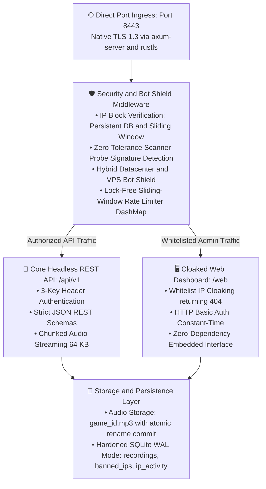

# System Architecture

The **League Voice Recorder Backend** is a high-performance, asynchronous audio storage and sync service written in **Rust** using the [Axum](https://github.com/tokio-rs/axum) web framework and the [Tokio](https://tokio.rs/) asynchronous runtime.

---

## 1. High-Level Design Principles



### 1.1 Direct Internet Exposure (Native TLS 1.3)
Unlike architectures that mandate an external Nginx or Caddy reverse proxy, the service terminates TLS 1.3 directly on port `8443` using OpenSSL AEAD cipher suites (`TLS_AES_256_GCM_SHA384`, `TLS_CHACHA20_POLY1305_SHA256`). This eliminates proxy buffering timeouts during large scrimmage audio transfers (up to 250 MB).

### 1.2 Thread-Safe Lock-Free Concurrency
Rate limiting, connection tracking, active ban state, and IP intelligence caches are maintained in memory via lock-free concurrent hash tables (`DashMap`). Mutex contention is completely avoided, allowing thousands of simultaneous operations with sub-millisecond overhead.

### 1.3 Hardened SQLite WAL Storage
The database engine runs SQLite in Write-Ahead Logging mode (`PRAGMA journal_mode=WAL;`), normal synchronization (`PRAGMA synchronous=NORMAL;`), and a 30-second busy timeout. Read operations never block write operations.

---

## 2. Directory Hierarchy

```text
league-voice-recorder-backend/
├── Cargo.toml                # Rust project manifest and crate dependencies
├── Cargo.lock                # Deterministic dependency lockfile
├── Dockerfile                # Hardened multi-stage Alpine build
├── docker-compose.yml        # Docker compose configuration
├── .env.example              # Configuration environment template
├── README.md                 # Concise project overview
├── AGENTS.md                 # AI agent and developer instruction manual
├── docs/                     # Modular documentation chapters
│   ├── ARCHITECTURE.md       # High-level architecture (this file)
│   ├── SECURITY_AND_BOT_SHIELD.md # Three-key auth, scanner/probe detection, hybrid VPS shield
│   ├── AUDIO_PIPELINE.md     # MP3 chunked upload, validation, SHA-256, Range streaming
│   ├── API_REFERENCE.md      # OpenAPI/REST endpoints reference
│   ├── WEB_DASHBOARD.md      # Embedded cloaked UI and security operations
│   └── DEPLOYMENT.md         # TLS setup, Docker, and production operations
├── src/
│   ├── main.rs               # Server startup, TLS listener, lifecycle hooks
│   ├── lib.rs                # Core library definition and global middleware stack
│   ├── config.rs             # Configuration validation and environment loader
│   ├── db/
│   │   ├── mod.rs            # Database connection pool (SqlitePool) & pragmas
│   │   └── models.rs         # Database schema structs (Recording, BannedIP, etc.)
│   ├── security/
│   │   ├── mod.rs            # Security module root
│   │   ├── auth.rs           # 3-key authentication & constant-time validation
│   │   ├── rate_limiter.rs   # Sliding window rate limiter & brute force protection
│   │   ├── scanner.rs        # Scanner probe signature detection & heuristic bans
│   │   └── cert.rs           # TLS cert validation and dev ECDSA self-signed generation
│   ├── bot_shield/
│   │   ├── mod.rs            # Bot shield module root
│   │   └── ip_intel.rs       # Hybrid Datacenter/VPS bot detection (offline + ip-api.com)
│   ├── audio/
│   │   ├── mod.rs            # Audio module root
│   │   ├── mp3.rs            # Pure Rust MP3 frame parser, duration, bitrate, sample rate
│   │   └── storage.rs        # Chunked streaming upload, hash computation, range streaming
│   ├── api/
│   │   ├── mod.rs            # API router (/api/v1)
│   │   ├── health.rs         # GET /api/v1/health
│   │   └── recordings.rs     # Upload, list, metadata, download, delete endpoints
│   └── web/
│       ├── mod.rs            # Web module router (/web)
│       ├── auth.rs           # IP whitelist & HTTP Basic Auth
│       ├── router.rs         # Dashboard endpoints, streaming, download, upload, security
│       └── dashboard.html    # Zero-dependency modern dark dashboard template
└── tests/
    ├── common/mod.rs         # Test fixtures, mock MP3 generator, test app builder
    ├── test_api.rs           # Health, query, pagination, delete tests
    ├── test_upload.rs        # Streaming upload, sha256 validation, duplicate check
    ├── test_download.rs      # Resumable range requests (206 Partial Content)
    ├── test_security.rs      # 3-key auth, brute-force IP blocking, scanner probe detection
    └── test_web.rs           # Web dashboard, basic auth, IP whitelisting
```
