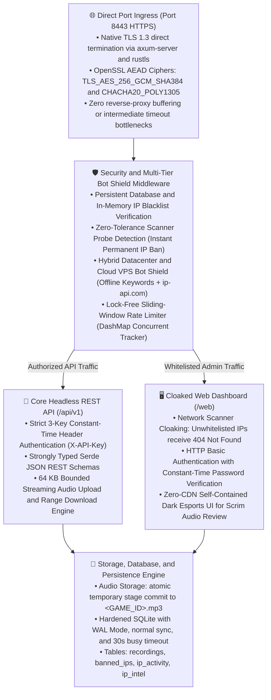

# System Architecture

The **League Voice Recorder Backend** is a high-performance, asynchronous audio storage and sync service written in **Rust** using the [Axum](https://github.com/tokio-rs/axum) web framework and the [Tokio](https://tokio.rs/) asynchronous runtime.

---

## 1. High-Level Design Principles



### 1.1 Direct Internet Exposure (Native TLS 1.3)
Unlike legacy architectures that mandate an external Nginx, Apache, or Caddy reverse proxy, the service terminates TLS 1.3 directly on port `8443` using OpenSSL AEAD cipher suites (`TLS_AES_256_GCM_SHA384` and `TLS_CHACHA20_POLY1305_SHA256`). 

Direct-port ingress provides significant operational advantages:
- **Zero Proxy Buffering**: Standard reverse proxies buffer incoming requests into temporary disk files before forwarding to backend apps. This causes fatal upload dropouts and 504 Gateway Timeouts for large audio transfers (up to 250 MB).
- **Sub-Millisecond Handshakes**: Axum-server negotiates TLS handshakes natively with zero proxy hops, delivering sub-millisecond response latencies.
- **Simplified Operations**: Eliminates separate web server configuration files, proxy header passing bugs, and multi-container ingress orchestration.

### 1.2 Thread-Safe Lock-Free Concurrency
Rate limiting, connection tracking, active ban state, and IP intelligence caches are maintained in memory via lock-free concurrent hash tables (`DashMap`). Mutex contention is completely avoided across Tokio worker threads:
- **DashMap Sharded Locking**: Read operations execute concurrently without blocking other reader or writer threads.
- **Sliding-Window Token Buckets**: Failed authentication attempts and rate-limit windows are tracked in microsecond timestamps.
- **Zero Memory Allocation Overhead**: State objects are allocated once at server startup and shared across all request handlers via `Arc<AppState>`.

### 1.3 Hardened SQLite WAL Storage
The database engine runs SQLite via `sqlx::SqlitePool` with optimized concurrency pragmas:
- `PRAGMA journal_mode = WAL;`: Write-Ahead Logging allows concurrent readers to query the database while a writer is appending new recording metadata.
- `PRAGMA synchronous = NORMAL;`: Reduces disk sync operations without sacrificing database integrity in WAL mode.
- `PRAGMA busy_timeout = 30000;`: 30-second busy timeout eliminates "database is locked" errors under heavy concurrent scrimmage uploads.
- `PRAGMA foreign_keys = ON;`: Enforces relational integrity across tables.

### 1.4 Real-Time Structured Access Logging & Noise Suppression
Every incoming request is processed by a custom Tokio middleware layer in `src/lib.rs`:
- **Real-Time Request Telemetry**: Logs client IP, HTTP method, path, HTTP response status code, and latency in microseconds (`µs`) or milliseconds (`ms`).
- **Healthcheck Noise Suppression**: Container monitoring agents probe `/api/v1/health` every 15–30 seconds. To prevent Docker logs from being spammed with thousands of redundant lines, successful health checks (`200 OK`) are automatically filtered out from console logs. If a health probe ever returns an error, it is instantly logged at warning/error level.

### 1.5 Bounded Memory Footprint (1.35 MiB Resident RAM)
By avoiding garbage-collected runtimes and using zero-copy byte streaming, the entire application consumes **under 1.35 MiB of resident RAM** in production. Memory usage remains completely flat regardless of whether the server is idling or streaming multiple concurrent 100 MB recordings.

---

## 2. Directory Hierarchy

```text
league-voice-recorder-backend/
├── Cargo.toml                # Rust project manifest and crate dependencies
├── Cargo.lock                # Deterministic dependency lockfile
├── Dockerfile                # Hardened multi-stage Alpine build
├── docker-compose.yml        # Docker compose configuration
├── .env.example              # Configuration environment template
├── README.md                 # Concise project overview
├── AGENTS.md                 # AI agent and developer instruction manual
├── docs/                     # Modular documentation chapters
│   ├── ARCHITECTURE.md       # High-level architecture (this file)
│   ├── SECURITY_AND_BOT_SHIELD.md # Three-key auth, scanner/probe detection, hybrid VPS shield
│   ├── AUDIO_PIPELINE.md     # MP3 chunked upload, validation, SHA-256, Range streaming
│   ├── API_REFERENCE.md      # OpenAPI/REST endpoints reference
│   ├── WEB_DASHBOARD.md      # Embedded cloaked UI and security operations
│   └── DEPLOYMENT.md         # TLS setup, Docker, and production operations
├── src/
│   ├── main.rs               # Server startup, TLS listener, lifecycle hooks
│   ├── lib.rs                # Core library definition and global middleware stack
│   ├── config.rs             # Configuration validation and environment loader
│   ├── db/
│   │   ├── mod.rs            # Database connection pool (SqlitePool) & pragmas
│   │   └── models.rs         # Database schema structs (Recording, BannedIP, etc.)
│   ├── security/
│   │   ├── mod.rs            # Security module root
│   │   ├── auth.rs           # 3-key authentication & constant-time validation
│   │   ├── rate_limiter.rs   # Sliding window rate limiter & brute force protection
│   │   ├── scanner.rs        # Scanner probe signature detection & heuristic bans
│   │   └── cert.rs           # TLS cert validation and dev ECDSA self-signed generation
│   ├── bot_shield/
│   │   ├── mod.rs            # Bot shield module root
│   │   └── ip_intel.rs       # Hybrid Datacenter/VPS bot detection (offline + ip-api.com)
│   ├── audio/
│   │   ├── mod.rs            # Audio module root
│   │   ├── mp3.rs            # Pure Rust MP3 frame parser, duration, bitrate, sample rate
│   │   └── storage.rs        # Chunked streaming upload, hash computation, range streaming
│   ├── api/
│   │   ├── mod.rs            # API router (/api/v1)
│   │   ├── health.rs         # GET /api/v1/health
│   │   └── recordings.rs     # Upload, list, metadata, download, delete endpoints
│   └── web/
│       ├── mod.rs            # Web module router (/web)
│       ├── auth.rs           # IP whitelist & HTTP Basic Auth
│       ├── router.rs         # Dashboard endpoints, streaming, download, upload, security
│       └── dashboard.html    # Zero-dependency modern dark dashboard template
└── tests/
    ├── common/mod.rs         # Test fixtures, mock MP3 generator, test app builder
    ├── test_api.rs           # Health, query, pagination, delete tests
    ├── test_upload.rs        # Streaming upload, sha256 validation, duplicate check
    ├── test_download.rs      # Resumable range requests (206 Partial Content)
    ├── test_security.rs      # 3-key auth, brute-force IP blocking, scanner probe detection
    └── test_web.rs           # Web dashboard, basic auth, IP whitelisting
```
