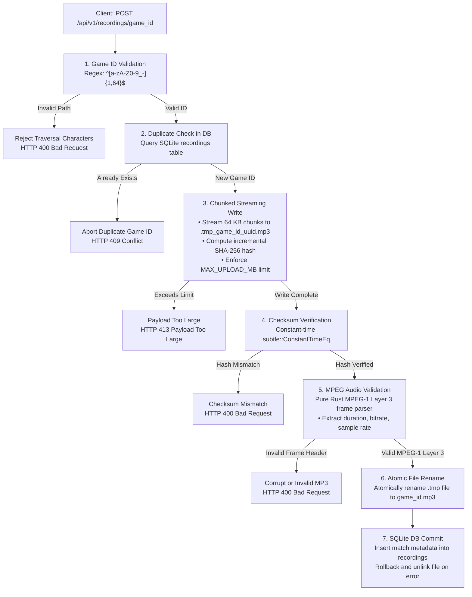

# Audio Pipeline & Storage Mechanics

The audio subsystem is built for streaming high-capacity audio uploads and resumable partial downloads while maintaining bounded memory consumption.

---

## 1. Upload Processing Pipeline

### 1.1 Game ID Sanitization
- Validated against regex: `^[a-zA-Z0-9_-]{1,64}$`.
- Characters such as `/`, `\`, `..`, and null bytes are rejected with `400 Bad Request`.

### 1.2 Bounded Memory Streaming
- Audio is never buffered entirely into memory.
- Files stream chunk-by-chunk using a 64 KB buffer directly to disk.

### 1.3 Pure Rust MPEG Frame Parsing
- Inspects MPEG-1 Audio Layer III frame headers (skipping ID3v2 metadata if present).
- Calculates exact duration: `(total_frames * 1152) / sample_rate`.
- Extracts bitrate (kbps) and sample rate (Hz).
- Requires zero external C libraries (no ffmpeg, no libmp3lame).

---

## 2. Resumable Downloads & HTTP Range Requests

Clients, VLC players, synchronizers, and browsers query:
`GET /api/v1/recordings/{game_id}/download`

### 2.1 Range Header Support
The storage layer parses HTTP Range headers:
- `Range: bytes=0-1048575` (first 1 MB)
- `Range: bytes=1048576-` (from byte 1 MB to EOF)
- `Range: bytes=-524288` (suffix range: last 512 KB)

### 2.2 Response Specifications
- **Valid Range**: Returns `206 Partial Content` with `Content-Range: bytes start-end/total` and `Content-Length`.
- **Invalid / Out-of-bounds Range**: Returns `416 Range Not Satisfiable` with `Content-Range: bytes */total`.
- **Full File Request**: Returns `200 OK` with `Accept-Ranges: bytes` and `Content-Disposition: attachment; filename="<game_id>.mp3"`.
