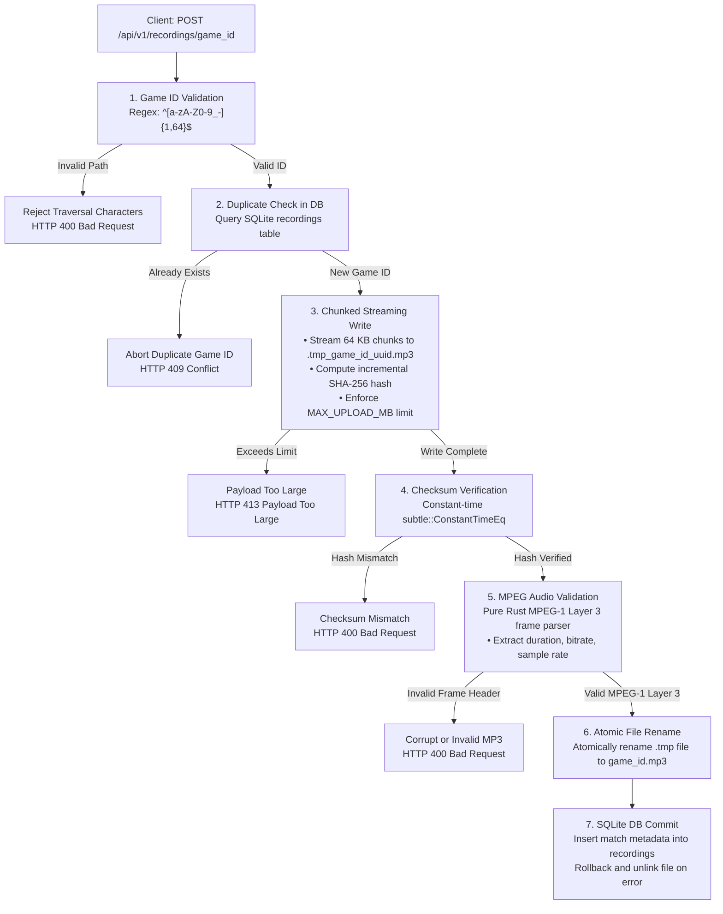

# Audio Pipeline & Storage Mechanics

The audio subsystem is built for streaming high-capacity audio uploads and resumable partial downloads while maintaining bounded memory consumption.

---

## 1. Upload Processing Pipeline



### 1.1 Game ID Sanitization & Path Traversal Defense
- **Regex Boundary**: Every game ID parameter is validated strictly against `^[a-zA-Z0-9_-]{1,64}$`.
- **Injection Prevention**: Any input containing path traversal sequences (`../`, `..\`), directory separators (`/`, `\`), or null bytes (`\0`) is immediately rejected with `400 Bad Request`.
- **Reserved Names**: Protects against OS-reserved filenames (such as `CON`, `PRN`, `AUX`, `NUL` on Windows clients).

### 1.2 Bounded Memory Streaming (64 KB Chunks)
- **Zero Full-File Buffering**: The server never buffers complete audio recordings in memory (`tokio::fs::read` is strictly prohibited).
- **Stream Flow**: Uploads stream chunk-by-chunk using a fixed 64 KB buffer (`CHUNK_SIZE = 64 * 1024`) directly from the incoming HTTP multipart/binary stream to an isolated temporary file on disk (`.tmp_<game_id>_<uuid>.mp3`).
- **Real-Time Cryptographic Hashing**: An incremental SHA-256 digest (`ring::digest::Context`) processes each 64 KB chunk in-flight as it passes through memory, computing the exact checksum with zero secondary disk reads.
- **Upload Size Guard**: If the incoming byte stream exceeds `MAX_UPLOAD_MB` (default 250 MB), the upload is terminated immediately and returns `413 Payload Too Large`, unlinking the partial temporary file.

### 1.3 Checksum Verification & Timing-Attack Prevention
- Clients may supply an expected SHA-256 hash via the `X-Checksum-SHA256` HTTP header.
- The computed in-flight hash is compared against the client's provided checksum using **constant-time equality** (`subtle::ConstantTimeEq`).
- If a hash mismatch occurs (e.g. corrupted network transfer), the temporary file is unlinked and the request returns `400 Bad Request`.

### 1.4 Pure Rust MPEG-1 Layer 3 Frame Parsing
The audio engine validates audio stream validity using a pure-Rust MPEG frame parser without invoking external C libraries (such as FFmpeg, libmp3lame, or SoX):
- **ID3v2 Header Bypass**: Automatically detects and safely skips ID3v2 metadata tags by decoding the 4-byte sync-safe integer length.
- **Frame Sync Word**: Scans for the MPEG-1 Layer III 11-bit sync word (`0x7FF` / `0xFFE0`).
- **Header Bitfields**: Extracts MPEG audio version, layer index, bitrate index, sampling frequency, and padding bit.
- **Frame Length Calculation**:
  ```text
  FrameSize = ((144 * Bitrate_bps) / SampleRate_Hz) + Padding
  ```
- **Playback Duration Calculation**:
  ```text
  Duration_Seconds = (Total_Valid_Frames * 1152) / SampleRate_Hz
  ```
- **Integrity Validation**: Rejects non-audio payloads, corrupted streams, or disguised executables with `400 Bad Request`.

### 1.5 Atomic Two-Phase Commit & Rollback
- Audio files are initially staged with unique temporary filenames (`.tmp_<game_id>_<uuid>.mp3`).
- Once validation succeeds, the file is atomically renamed to `<game_id>.mp3` using filesystem-level atomic rename (POSIX `rename()`).
- If SQLite metadata insertion fails, a database rollback is executed and the audio file is cleanly deleted from disk.

---

## 2. Resumable Downloads & HTTP Range Requests

Clients, VLC players, desktop synchronizers, and browsers query:
`GET /api/v1/recordings/{game_id}/download`

### 2.1 RFC 7233 Range Header Specifications
The storage layer parses HTTP Range headers for seamless audio scrubbing and resumed downloads:
- **Explicit Range**: `Range: bytes=0-1048575` (requests the first 1 MB chunk).
- **Open-Ended Range**: `Range: bytes=1048576-` (requests from 1 MB through EOF).
- **Suffix Range**: `Range: bytes=-524288` (requests the final 512 KB of the file).

### 2.2 Response Specifications
- **Valid Range**: Returns `206 Partial Content` with `Content-Range: bytes <start>-<end>/<total>` and `Content-Length`.
- **Invalid / Out-of-bounds Range**: Returns `416 Range Not Satisfiable` with `Content-Range: bytes */<total>`.
- **Standard Request (No Range)**: Returns `200 OK` with `Accept-Ranges: bytes` and `Content-Disposition: attachment; filename="<game_id>.mp3"`.

---

## 3. Storage Directory Hierarchy

Audio files and SQLite WAL databases are organized cleanly in persistent storage:

```text
data/
├── recordings/
│   ├── 8018190134.mp3       # Complete verified scrimmage recording
│   ├── 8018190135.mp3       # Complete verified scrimmage recording
│   └── .tmp_8018190136_*.mp3# In-flight chunked streaming staging file
└── db.sqlite                # Hardened SQLite database with WAL and busy timeout
```
